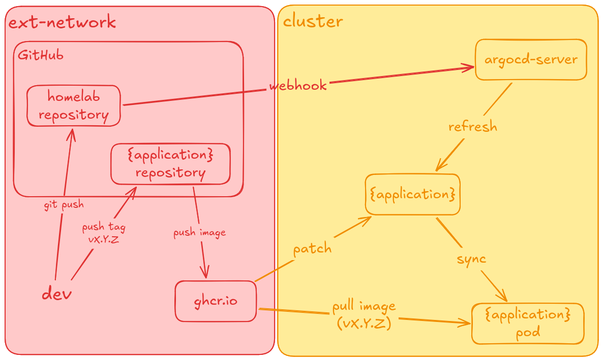
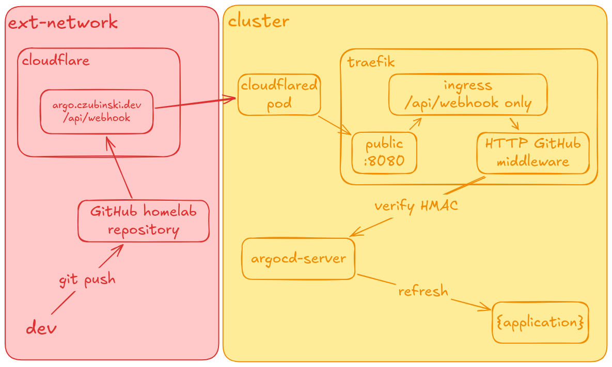
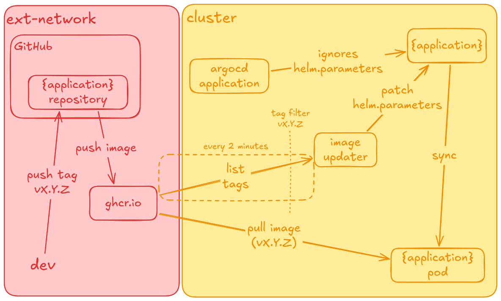

# Argo CD

## Overview

Argo CD runs in the cluster and keeps it in sync with this repo. Everything under `infra/`, `apps/` and `tools/` is applied by Argo.

- **Source of truth:** `git@github.com:MescoCzubinski/homelab.git`, branch `main`
- **Sync policy:** automated, with `prune` and `selfHeal`, so manual changes in the cluster are reverted
- **Image tags:** the only thing not in git, see [Image Updater](#image-updater)

## App of apps

One parent Application, `argocd`, manages Argo itself and every file in `infra/argocd/applications/`. The parent deploys:

- the Argo CD chart itself, including the GUI and its VPN-only ingress (`server.ingress`)
- the webhook ingress `ingress-gh.yaml`
- `sealed-secret.yaml` and `networkpolicy.yaml` from `infra/argocd`
- one child Application per file in `applications/`

## Sources

- **Helm chart:** up to three sources, so the chart comes from upstream (or `charts/app`) and the values stay in this repo:
  1. Helm chart, values from `$values/...`
  2. this repo, only `ref: values`, so `$values` points at it
  3. this repo, `path` with extra manifests (ingress, sealed secrets)
- **Plain manifests:** a single source, a `path` in this repo.

## Cleanup

What's in the repo is what's on the server, also when something is removed.

- **Prune:** a resource removed from a file is deleted on the next sync
- **Finalizer:** deleting a child's file in `applications/` deletes everything it deployed, except CRDs with `helm.sh/resource-policy: keep`
- **No finalizer:** `argocd` (would take Argo down), `sealed-secrets` and `traefik` (CRDs without `keep`, all SealedSecrets and IngressRoutes would go). `argocd app delete` still cascades, `--cascade=false` prevents it
- **Left behind:** namespaces, data in `/home/server/`, released static PVs
- **Orphans:** `orphanedResources.warn` in `appproject.yaml` reports resources missing from git in Argo and on Discord, operator-made ones excluded
- **Outside Argo:** `cluster/` (k0sctl), Image Updater tags, host directories

## Webhook

A push to this repo triggers a GitHub webhook to `argo.czubinski.dev/api/webhook`, so Argo refreshes right away instead of waiting for its next scheduled check.

- **Ingress:** `ingress-gh.yaml` exposes only `/api/webhook` on `argo.czubinski.dev` through the `public` entrypoint, the GUI on `argocd.czubinski.dev` is VPN-only
- **Middleware:** `http-gh-only` lets through only GitHub's webhook IP ranges, read from `X-Forwarded-For` because requests arrive through `cloudflared`
- **Signature:** `configs.secret.githubSecret` reads `argocd-webhook:github`, so Argo rejects payloads not signed with that secret

## Image Updater

Argo CD Image Updater watches GHCR and moves each app to the newest semver tag, without a commit to this repo.

- **Config:** one `ImageUpdater` custom resource per app in `infra/argocd-image-updater/image-updaters.yaml`
- **Tags:** only `vX.Y.Z` is considered (`allowTags`), strategy `semver`
- **Write-back:** `method: argocd`, so the new tag is stored as `helm.parameters` on the Application, not in git
- **Baseline:** `tag: v0.0.1` in each app's `values.yaml` is only the starting point, the live tag is in the cluster
- **Registry:** `ghcr.io`, credentials from `argocd/ghcr-pull`

## Renovate

Renovate covers what the Image Updater doesn't, and opens pull requests instead of changing the cluster directly. It watches `tools/`, `infra/cloudflared` and chart versions in `infra/argocd/applications/`.

- **Major:** pull request any time
- **Minor:** pull request only on the 1st of the month, so a package gets at most one a month
- **Patch:** pull request any time, separate from a pending minor, merged by Renovate (rebase) once checks pass
- **Release age:** a version must be at least 3 days old
