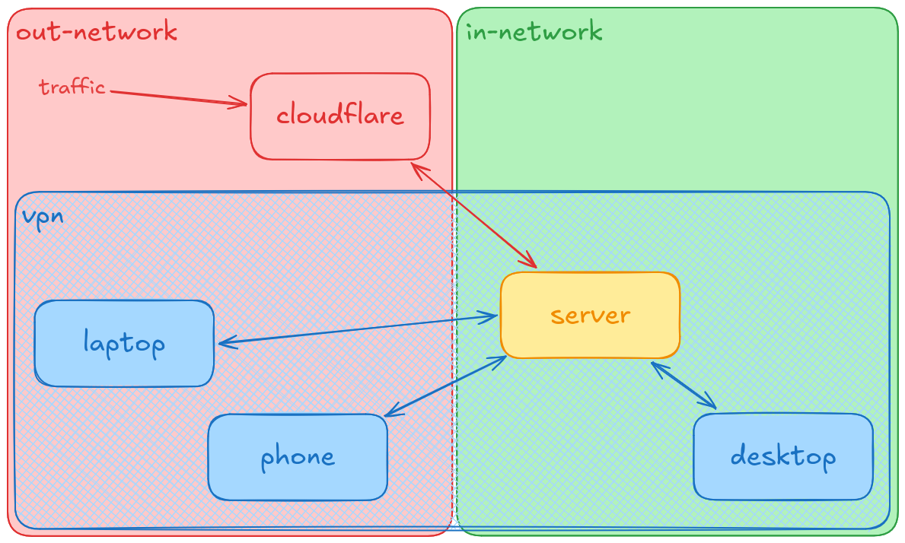
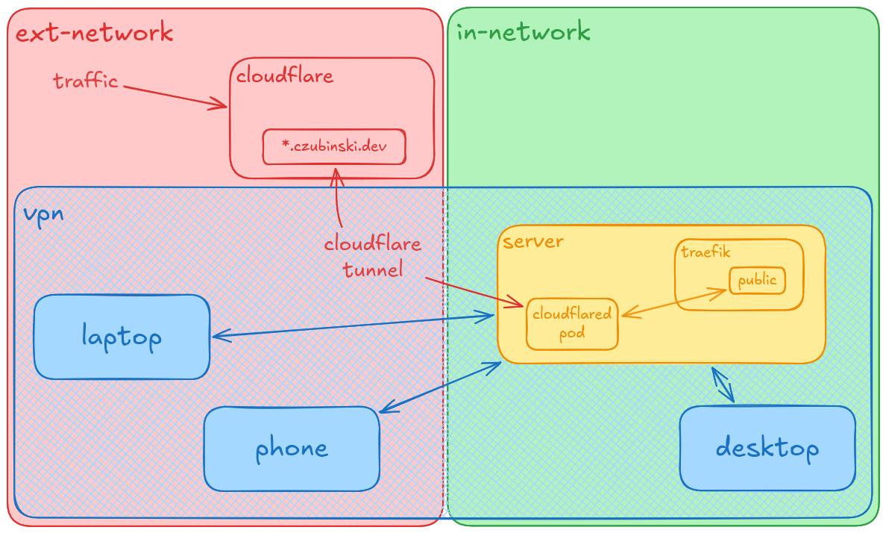
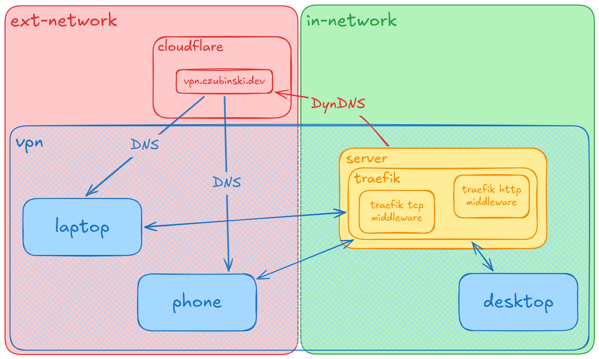
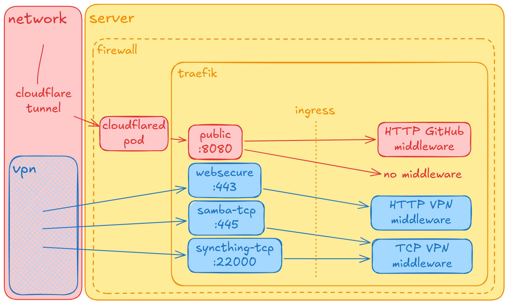

# Network

## Overview

There are two ways to reach the server. Public traffic goes through Cloudflare and a tunnel, so no ports are opened. Private traffic goes through the VPN and can reach everything else.

## Public traffic

`*.czubinski.dev` is proxied by Cloudflare, which also terminates TLS. The `cloudflared` pod opens an outbound tunnel to Cloudflare, so public requests come back through it into the cluster and reach Traefik's `public` entrypoint.

Traefik trusts `X-Forwarded-*` headers from `cloudflared` (`trustedIPs: 10.244.0.0/16`), so apps see the real client IP.

## VPN

The server updates `vpn.czubinski.dev` with DynDNS. VPN clients resolve this name to find the server, and the record is DNS-only (not proxied). Once connected, devices can reach Traefik's private entrypoints on `192.168.0.1`.

The home network (in-network) is not treated as trusted. Being on the same LAN gives no access, so the desktop connects through the VPN like the laptop and phone. The only exception is SSH (key-only), kept open on the LAN as a fallback when the VPN breaks.

## Firewall

Router: static IP `192.168.1.100` for the server, only WireGuard `51820/udp` forwarded to it.

Server (firewalld):

| zone                     | matches               | open                                     |
| ------------------------ | --------------------- | ---------------------------------------- |
| `FedoraServer` (default) | LAN, `enp1s0f0`       | `51820/udp`, ssh, dhcpv6-client          |
| `vpn`                    | WireGuard, `wg0`      | `443`, `445`, `6443`, `22000` (tcp), ssh |
| `trusted`                | pods, `10.244.0.0/16` | everything                               |

`443`, `445` and `22000` are Traefik entrypoints, `6443` is the Kubernetes API (kubectl over VPN).

## NetworkPolicies

Traffic inside the cluster is closed by default and opened one path at a time. Every app, tool and infra namespace is default-deny for incoming traffic, and each policy allows one source to reach one destination. A compromised pod therefore can't reach its neighbours.

- **Apps and tools:** accept traffic only from the `traefik` namespace, so nothing is reachable except through Traefik. Gatus is also allowed in, to probe the services.
- **Databases:** an app's `<app>-pg` pods accept traffic only from the app itself and from `cnpg-system`, see [database.md](database.md#access).
- **Public apps:** also have egress rules, because they are the most likely to be compromised. They can reach DNS, their own namespace and the internet, but not the LAN, the node (kubelet, API server) or other namespaces. Only the database reaches the API server, which CloudNativePG needs.
- **Infra:** `argocd`, `cloudflared`, `traefik`, `cnpg-system` and `sealed-secrets` allow only what they need. `cloudflared` allows nothing in, since it only makes outbound connections. The API server runs on the host network, so the webhook ports of `cnpg-system` and `sealed-secrets` are open to anywhere.

Policies are named `<from>-to-<to>`, after the direction of the traffic they allow, e.g. `traefik-to-<app>` or `<app>-to-dns`. A policy lives in the namespace it protects, and `nobody-to-<namespace>` is the default-deny. The policies of apps come from `charts/app`, those of tools and infra from their own directories.

## Traefik

Entrypoints decide where traffic comes in. Middlewares decide who is allowed through.

| entrypoint             | reachable from               | middleware               |
| ---------------------- | ---------------------------- | ------------------------ |
| `public :8080`         | `cloudflared` only (cluster) | none, or GitHub IPs only |
| `websecure :443`       | VPN                          | HTTP VPN only            |
| `samba-tcp :445`       | VPN                          | TCP VPN only             |
| `syncthing-tcp :22000` | VPN                          | TCP VPN only             |

Ports in `values.yaml`: `port` is where Traefik listens in the pod, `exposedPort` is the Service port (used only by `public`), `hostPort` is the port on the VPN IP `192.168.0.1`. `additionalArguments` override entrypoint addresses to `:<port>`, because the chart prefixes them with `hostIP`, which doesn't exist inside the pod.

## TLS

- **Public:** Cloudflare terminates TLS, and the tunnel to `cloudflared` is encrypted.
- **VPN:** Traefik serves a Let's Encrypt wildcard cert for `czubinski.dev` and `*.czubinski.dev` on `websecure`. It is issued through the Cloudflare DNS challenge, so no open port is needed, and stored in an `emptyDir`, so it is re-issued when the pod restarts.
