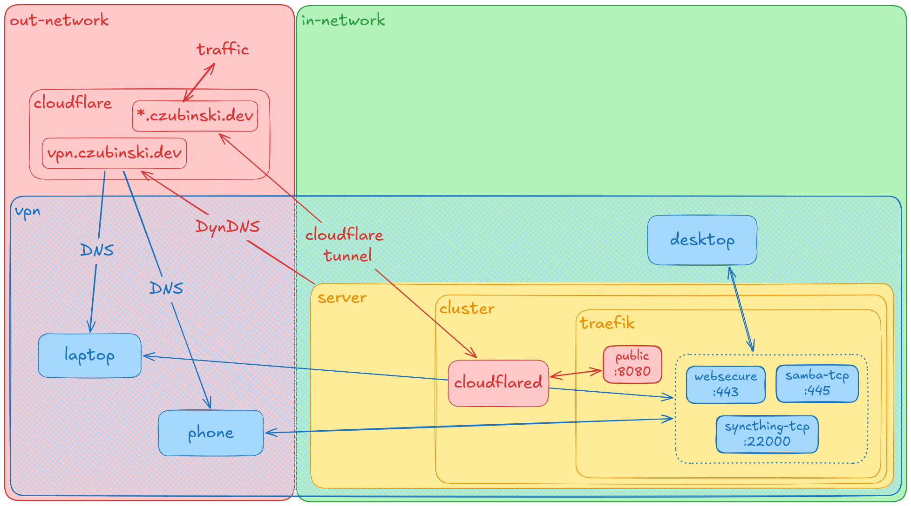

# Homelab

Single-node Kubernetes homelab on a Mac Mini, run with k0s and managed by Argo CD in GitOps style. Public apps are reached through a Cloudflare Tunnel with no open ports, while private tools sit behind a VPN.



## Stack

| Layer         | Tool                                                                                                                |
| ------------- | ------------------------------------------------------------------------------------------------------------------- |
| Hardware      | Mac Mini 2012, i7-3720QM, 16 GB RAM, 250 GB SSD ([hardware.md](.docs/hardware.md))                                  |
| Kubernetes    | [k0s](https://k0sproject.io), config in [cluster/k0sctl.yaml](cluster/k0sctl.yaml)                                  |
| GitOps        | [Argo CD](https://argo-cd.readthedocs.io) ([argocd.md](.docs/argocd.md))                                            |
| Ingress       | [Traefik](https://traefik.io), config in [infra/traefik/values.yaml](infra/traefik/values.yaml)                     |
| Public access | [Cloudflare Tunnel](https://developers.cloudflare.com/cloudflare-one/connections/connect-networks/) (`cloudflared`) |
| Database      | [CloudNativePG](https://cloudnative-pg.io) ([database.md](.docs/database.md))                                       |
| Secrets       | [Sealed Secrets](https://github.com/bitnami-labs/sealed-secrets)                                                    |
| Updates       | [Renovate](https://docs.renovatebot.com) and Argo CD Image Updater ([argocd.md](.docs/argocd.md))                   |
| CI            | [GitHub Actions](https://docs.github.com/actions)                                                                   |

## File structure

```
.github/          CI workflow
cluster/          k0s cluster config
charts/
  app/            Helm chart for my own apps
infra/
  argocd/         Argo CD itself + applications/
  argocd-image-updater/ Image Updater + ImageUpdater CRs
  cloudflared/    Cloudflare Tunnel
  kube-vip/       Virtual IP for the API server
  postgres/       Postgres cluster (the CloudNativePG operator comes from the upstream chart)
  sealed-secrets/ Sealed Secrets controller
  traefik/        Traefik values, middlewares
apps/             my own apps
  atlas/
  homepage/
  meetly/
tools/            self-hosted tools
  beszel/
  convertx/
  gatus/
  samba/
  stirling/
  syncthing/
.docs/            docs and diagrams
```

Every app in `apps/` is a `values.yaml` for the shared [charts/app](charts/app/) Helm chart (Deployment, Service, Ingress), plus `sealed-secret.yaml` if needed. Every tool in `tools/` has its own Application: a plain directory of manifests, or `values.yaml` for an upstream chart where a usable one exists (now: Stirling PDF, Gatus). Argo CD entrypoint is [infra/argocd/applications/](infra/argocd/applications/), details in [.docs/argocd.md](.docs/argocd.md).

## Services

| Service                         | Address                                      | Access                                  |
| ------------------------------- | -------------------------------------------- | --------------------------------------- |
| [homepage](apps/homepage/)      | `czubinski.dev`                              | public                                  |
| [atlas](apps/atlas/)            | `atlas.czubinski.dev`                        | public                                  |
| [meetly](apps/meetly/)          | `meetly.czubinski.dev`                       | public                                  |
| [Argo CD](infra/argocd/)        | `argocd.czubinski.dev`, `argo.czubinski.dev` | VPN, webhook public for GitHub IPs only |
| [Beszel](tools/beszel/)         | `beszel.czubinski.dev`                       | VPN                                     |
| [ConvertX](tools/convertx/)     | `convert.czubinski.dev`                      | VPN                                     |
| [Gatus](tools/gatus/)           | `gatus.czubinski.dev`                        | VPN                                     |
| [Stirling PDF](tools/stirling/) | `stirling.czubinski.dev`                     | VPN                                     |
| [Syncthing](tools/syncthing/)   | `syncthing.czubinski.dev`, `:22000`          | VPN                                     |
| [Samba](tools/samba/)           | `:445`                                       | VPN                                     |

Tool details and where their data lives: [.docs/tools.md](.docs/tools.md).

## Networking

- **Public:** `*.czubinski.dev` goes through Cloudflare and the `cloudflared` tunnel to Traefik's `public` entrypoint. No ports are opened on the router.
- **VPN:** WireGuard via `vpn.czubinski.dev` (DynDNS). Connected devices reach Traefik's private entrypoints on `192.168.0.1`.

Diagrams, firewall, Traefik entrypoints and ingress snippets: [.docs/network.md](.docs/network.md).

## Roadmap

See [.docs/TODO.md](.docs/TODO.md).
